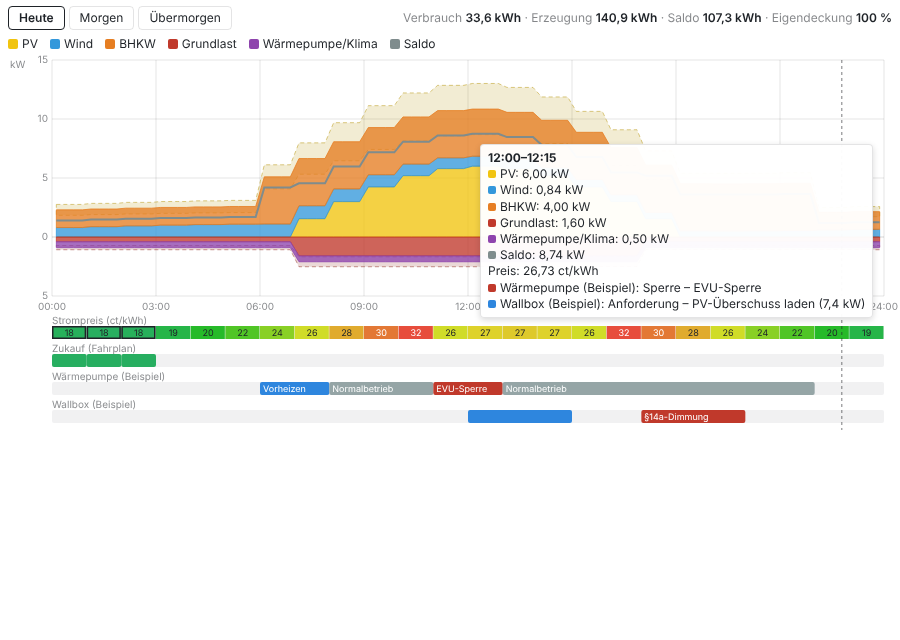

# Energiekachel

Kachel für die Kachel-Visualisierung: zeigt die Prognosen der Bibliothek farbig für **heute, morgen und übermorgen**
und darunter Strompreise, Zukaufplan und Fahrpläne.



## Inhalt der Kachel

- **Diagramm**: Erzeugung nach oben (PV, Wind, BHKW gestapelt), Verbrauch nach unten (Grundlast, Wärmepumpe/Klima,
  Wallbox gestapelt), Saldo als Linie, Unsicherheitsband P10–P90 gestrichelt, „jetzt“ als senkrechte Linie.
- **Legende** zum Ein-/Ausblenden einzelner Reihen, **Tooltip** mit allen Werten der Viertelstunde, **Tage** per Reiter.
- **Summen**: Verbrauch, Erzeugung, Saldo, Eigendeckung (Anteil des Verbrauchs, der zeitgleich selbst erzeugt wird).
- **Strompreis-Leiste** (grün = günstig, rot = teuer) mit Markierung der günstigsten Abschnitte je Tag.
- **Zukaufplan**: geplanter Netzbezug, z. B. vom EMS in günstige Stunden gelegt.
- **Fahrpläne**: beliebig viele Zeilen mit Blöcken für **Anforderung**, **Normalbetrieb** und **Sperre**.
- Alle Farben einstellbar; heller und dunkler Modus (folgt der Systemeinstellung des Geräts).

## Einrichtung

1. Instanz „Energiekachel“ anlegen und in der Kachel-Visualisierung platzieren.
2. Prognose-Instanzen wählen oder leer lassen (dann wird die erste vorhandene Instanz je Modul genutzt).
3. Zum Ausprobieren ohne EMS: **„Beispieldaten einspielen“** – zeigt zwei Fahrpläne, Preise und einen Zukaufplan.

## Fahrpläne, Preise und Zukauf anbinden (vorbereitet)

Zwei Wege, beliebig kombinierbar:

**a) String-Variablen mit JSON** (im Formular wählen; Änderungen erscheinen sofort):

```json
{"id": "wp", "name": "Wärmepumpe", "entries": [
  {"from": 1794812400, "to": 1794819600, "type": "request", "label": "Vorheizen", "kw": 3.0},
  {"from": "2026-11-17T11:00:00+01:00", "to": "2026-11-17T13:00:00+01:00", "type": "Sperre", "label": "EVU"}
]}
```

Eine reine Liste der Einträge genügt ebenfalls. `type`: `request`/`Anforderung`, `normal`/`Normalbetrieb`, `lock`/`Sperre`.
Zeiten als Unix-Sekunden, Millisekunden oder ISO-Text; statt `to` geht `duration` (Sekunden); Leistung `kw` oder `w`.

**b) Funktionen** (z. B. aus einem EMS-Skript):

| Befehl | Wirkung |
|---|---|
| `EPK_SetSchedule($id, $kennung, $name, $json)` | Fahrplan setzen/ersetzen (leere Liste entfernt ihn), Rückgabe: Anzahl Einträge |
| `EPK_RemoveSchedule($id, $kennung)` | Fahrplan entfernen |
| `EPK_SetPrices($id, $json)` | Strompreise setzen |
| `EPK_SetPurchasePlan($id, $json)` | Zukaufplan setzen (Liste mit `from`, `to`, `kw`/`kwh`, `label`) |
| `EPK_ClearPushed($id)` | alle per Funktion gesetzten Daten löschen |
| `EPK_Update($id)` | Kachel neu befüllen |
| `EPK_GetPayload($id)` | Daten der Kachel als Array (zum Prüfen) |

**Preisformate**, automatisch erkannt: Tibber (`{"today": [...], "tomorrow": [...]}` mit `total`/`startsAt`), aWATTar
(`{"data": [...]}` mit `marketprice` in €/MWh) und eigene Listen mit `from`/`to`/`price`. Einheit automatisch
(Angabe `unit` oder Größenordnung: Werte unter 2 gelten als €/kWh) oder fest im Formular. Angezeigt wird in ct/kWh.

Beispiel: Tibber-Preise aus einer Variable des Tibber-Moduls weiterreichen

```php
EPK_SetPrices(12345, GetValueString(23456));   // Variable mit der Preisliste (JSON)
```

## Grenzen

- Die Kachel nutzt die HTML-Schnittstelle der Kachel-Visualisierung (`SetVisualizationType`, `GetVisualizationTile`,
  `UpdateVisualizationValue`). Hell/Dunkel richtet sich nach der Systemeinstellung des Geräts; ob die Kachel-Visualisierung
  eigene Farbwerte vorgibt, ist nicht dokumentiert.
- Die HTML-Box für das ältere WebFront zeigt denselben Inhalt, wird aber nur bei jeder Aktualisierung neu geschrieben.
- Fahrpläne werden angezeigt, nicht ausgeführt – das Steuern bleibt Aufgabe des EMS bzw. der Ablaufpläne.
- Je Prognosemodul wird eine Instanz angezeigt (mehrere PV-Anlagen: je eine Kachel oder eine Solarprognose mit mehreren
  Generatoren).
